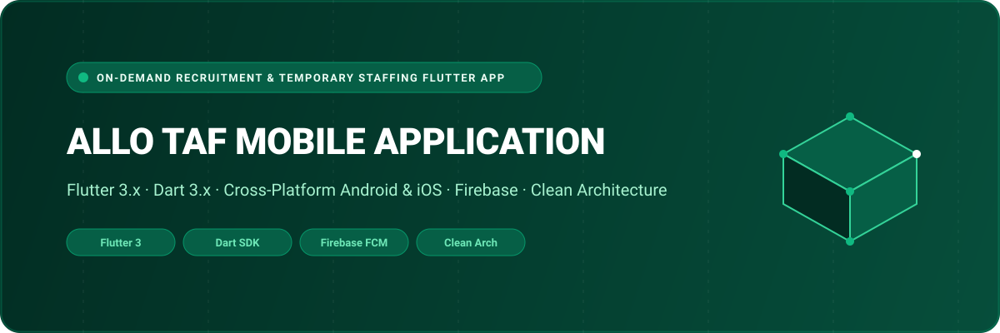

<div align="center">



# Allo Taf — On-Demand Recruitment & Temporary Staffing Mobile App

A cross-platform mobile application engineered with **Flutter** and **Dart** connecting enterprise recruiters with qualified temporary workers, artisans, and hourly contractors. Supports dual role onboarding (**Recruiter** vs **Jobseeker**), real-time push alerts, multilingual localization, and instant shift applications.

[](https://flutter.dev/)
[](https://dart.dev/)
[](https://firebase.google.com/)
[](https://developer.android.com/)
[](https://developer.apple.com/ios/)
[](LICENSE)

</div>

---

## 🌟 Overview

**Allo Taf** is a production mobile application streamlining rapid staffing in dynamic labor markets. Whether a company urgently needs hospitality workers, warehouse personnel, or skilled trade technicians, recruiters can post shift listings, review incoming applicant credentials, and dispatch work confirmations instantly.

Combined with [`Allo-Taf_Dashboard`](https://github.com/shahjalal-labs/Allo-Taf_Dashboard), operations teams maintain oversight across hiring activity, compliance verifications, and regional labor metrics.

---

## 🚀 Key Features & Capabilities

- 👥 **Dual-Role Architecture**: Adaptive experience tailored for **Jobseekers** (browse shifts, one-tap apply, track earnings) and **Recruiters** (post jobs, candidate screening, shift management).
- ⚡ **Instant Shift Discovery & Matching**: Proximity-based and category-based job filtering with real-time availability matching.
- 🔔 **Push Notifications & Status Tracking**: Firebase Cloud Messaging (FCM) keeping candidates updated on application status, interview alerts, and shift confirmations.
- 🌍 **Multilingual Localization**: Seamless language switching supporting diverse workforces.
- 🏗️ **Clean Architecture**: Decoupled codebase separated into presentation, domain, and data layers for maintainability and testing.
- 📱 **Native Look & Feel**: Beautiful Material 3 widgets with smooth transitions across both iOS and Android viewports.

---

## 🏛️ System Architecture

```
[ Jobseekers & Candidates ]          [ Enterprise Recruiters ]
             │                                   │
             ▼                                   ▼
   [ Flutter Cross-Platform Client Application (Android / iOS) ]
   ├── Authentication & Role Gate (Recruiter / Candidate)
   ├── Features
   │   ├── Authentication (OTP & Credentials)
   │   ├── Recruiter (Shift Postings, Candidate Pipeline)
   │   ├── Employee (Job Search, One-Tap Apply, Timesheet)
   │   └── Language & Localization
   └── Core Services (HTTP Client, Session Store, Firebase FCM)
             │
             ▼ (REST API / HTTPS)
   [ Allo Taf Backend Services ]
```

---

## 📁 Repository Structure

```
Allo_Taf/
├── assets/
│   ├── banner.svg                  # Architectural SVG project banner
│   └── icons/                      # Custom iconography and vector assets
├── android/                        # Native Android Gradle configuration
├── ios/                            # Native iOS Xcode workspace
├── lib/
│   ├── core/                       # Shared network clients, theme, error models
│   ├── features/                   # Feature modules (Clean Architecture)
│   │   ├── authentication/         # Login, registration, OTP verification
│   │   ├── employee/               # Jobseeker profile, shift applications, earnings
│   │   ├── recruiter/              # Job posting, applicant screening, candidate roster
│   │   ├── language/               # Localization and translation dictionaries
│   │   └── splash/                 # App launch & onboarding splash screens
│   ├── routes/                     # Centralized navigation routing
│   ├── firebase_options.dart       # Firebase client configuration
│   ├── my_app.dart                 # Root MaterialApp setup
│   └── main.dart                   # Application bootstrap entrypoint
├── pubspec.yaml                    # Flutter dependencies and assets
└── analysis_options.yaml           # Strict Dart analyzer linting rules
```

---

## 💻 Tech Stack Specification

| Domain | Selected Technologies |
| :--- | :--- |
| **Framework** | Flutter 3.x (SDK >= 3.10) |
| **Language** | Dart 3.x (Null Safety) |
| **Cloud Services** | Firebase Core, Firebase Cloud Messaging (FCM) |
| **Design System** | Material Design 3, Cupertino Icons |
| **Platforms** | Android (API 21+), iOS (12.0+) |

---

## 🛠️ Getting Started & Local Development

### Prerequisites

- **Flutter SDK**: `v3.10.0` or higher
- **Android Studio** / **Xcode**
- **Java Development Kit (JDK)**: `v17` or higher

### 1. Clone the Repository

```bash
git clone https://github.com/shahjalal-labs/Allo_Taf.git
cd Allo_Taf
```

### 2. Install Flutter Packages

```bash
flutter pub get
```

### 3. Run on Emulator / Connected Device

```bash
flutter run
```

---

## 👨‍💻 Engineering & Authorship

Developed and engineered by **Md. Shahjalal**.

- **GitHub**: [@shahjalal-labs](https://github.com/shahjalal-labs)
- **Email**: [muhommodshahjalal@gmail.com](mailto:muhommodshahjalal@gmail.com)

---

## 📄 License

This project is open-source and available under the [ISC License](LICENSE).
